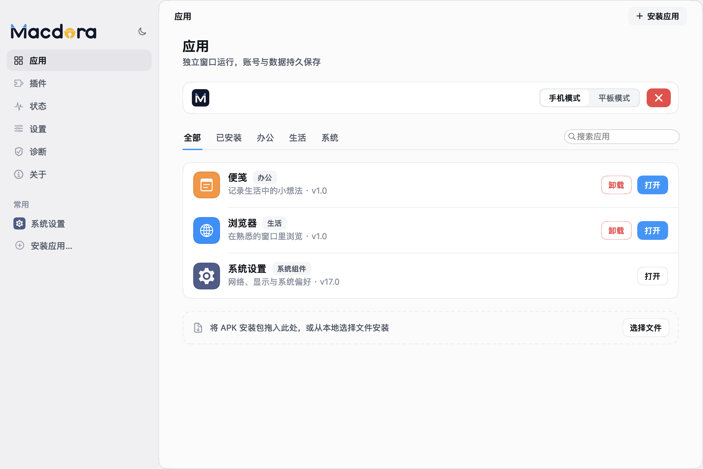
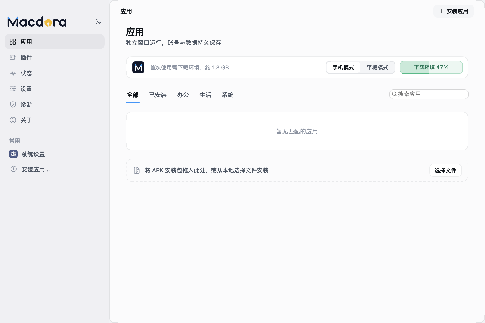

  <picture>
    <source media="(prefers-color-scheme: dark)" srcset="docs/assets/wordmark-dark.png">
    
  </picture>

  <h3>让 App 在 Mac 上更好用，也让 Agent 用得上。</h3>

  
一个从日常不方便出发，持续生长的 Mac 应用兼容平台。

  

    <a href="https://github.com/samwang0041-star/macdora/releases/latest">下载早期预览版</a> ·
    <a href="#为什么做-macdora">为什么做</a> ·
    <a href="#面向-agent-的下一步">Agent 方向</a> ·
    <a href="https://github.com/samwang0041-star/macdora/issues">反馈问题</a>
  

  

    
    
    
    
  

 

原生 macOS 界面。展示用 App 与下载进度均为演示数据。

## 为什么做 Macdora

我经常会遇到一个很具体的问题：人已经坐在 Mac 前，想做的事却还留在另一台设备、另一个系统，或者某个只提供移动端的 App 里。

我想把这些不方便一点点解决掉。先让 App 能在 Mac 上打开，再让窗口、键鼠、中文输入、安装和管理都尽量自然。能运行只是开始，真正值得反复打磨的是每天使用它的体验。

Macdora 就从这里开始。它目前以 Android App 为切入口，使用原生 macOS 界面管理独立的 Android 环境。长期来看，我希望它发展成一个 Mac 兼容平台，把更多原本不顺手的软件使用方式，变成 Mac 上可以顺畅完成的事情。

我会以产品经理的视角持续做下去：从自己的日常使用里找问题，把问题拆成具体场景，修交互、补反馈、减少步骤，再继续使用和验证。这个仓库也会记录产品本身的变化，而不只是存放一个最终版本。

## 现在能做什么

| 能力 | 当前体验 |
| --- | --- |
| 原生工作台 | 用原生 macOS 界面查看、安装、打开和管理 Android App，支持浅色与深色外观。 |
| 独立应用窗口 | 在独立窗口里使用 App，支持手机／平板模式与保持画面比例的窗口缩放。 |
| 键鼠与中文输入 | 复用 Mac 的输入法、键盘和鼠标；复制、粘贴由用户操作触发。 |
| 图形与设备适配 | 使用硬件视频解码与 Metal 呈现，持续改进 GPU、摄像头等适配体验。 |
| 轻量安装 | 安装包只带应用与必需的小组件。首次点击下载 Android 环境，显示真实进度；已有环境直接复用。 |
| 插件与软件更新 | 按需扩展功能，从同一个公开仓库检查、下载和安装新版，无需填写 GitHub Key。 |

<table>
  <tr>
    <td width="50%"></td>
    <td width="50%"></td>
  </tr>
  <tr>
    <td align="center">需要时再准备环境</td>
    <td align="center">逐步扩展平台能力</td>
  </tr>
</table>

## 面向 Agent 的下一步

我希望 Macdora 同时成为给人和 Agent 使用的平台。人需要直观、顺手的界面；Agent 需要知道当前有哪些 App、正在显示什么、可以执行哪些动作，以及动作到底有没有完成。

接下来，我会把关注点从“让 App 跑起来”，逐步移到“让 App 真正用起来”：

1. **先把人的使用体验做好。** 持续修复兼容性、显示、输入、窗口和环境管理中的具体问题。
2. **让平台理解 App。** 整理应用、会话、窗口和当前状态，逐步形成可以验证的状态描述。
3. **开放可控的动作接口。** 探索让 Agent 启动 App、查看界面、点击、输入、切换和结束会话，并收到明确的执行结果。
4. **让人与 Agent 协作。** 为授权、可见反馈、人工接管和中止保留清楚的边界，再探索 MCP 等接入方式。

**这些是演进方向。当前预览版还没有通用 Agent 控制 API 或 MCP 服务。** 我希望每一步都能落到实际场景里，而不是先把接口名称写满路线图。

## 开始使用

1. 从 [Releases](https://github.com/samwang0041-star/macdora/releases/latest) 下载 macOS arm64 安装包，解压并打开 `Macdora.app`。也可以将它放入“应用程序”文件夹。
2. 首次使用点击 **下载环境**。固定版本的 Android 依赖约 1.3 GB，下载与校验完成后准备运行环境。
3. 点击 **安装应用**，选择自己的 APK；安装完成后从工作台打开。

目前支持 **Apple Silicon Mac / macOS 15 及以上**。应用和 Android 数据分别保存，更新 Macdora 不需要重新下载已经准备好的同版本环境。

从 **0.04** 起，正式发布包使用 Developer ID 签名并通过 Apple 公证，公证票随应用封装。首次打开时，macOS 仍可能显示常规的下载确认。

## 这仍然是一个早期预览

现在的 Macdora 还有很多不完整的地方。不同 App 的安装、图形、输入和设备能力可能表现不同，也会有我还没有遇到的问题。当前只聚焦 Apple Silicon 上的 Android App，更多系统的兼容能力仍属于长期探索。

我把它开源，是想从现在开始记录自己的思考、问题和修复过程。不会每一步都走得很快，但我会继续使用它，也会把遇到的不方便慢慢改好。

如果你愿意试用，欢迎在 [Issues](https://github.com/samwang0041-star/macdora/issues) 写下你的场景、预期和实际结果。提交截图或日志前，请先移除账号、私人应用信息与其他敏感内容。

## 开源基础与借鉴

Macdora 建立在成熟的开源组件上。我希望把每个组件的作用、改动和来源交代清楚，并保留它们原有的许可证与版权声明。

| 项目 | 在 Macdora 中的作用 |
| --- | --- |
| [Android Emulator / AOSP](https://android.googlesource.com/platform/external/qemu/) | 独立 Android 运行环境，依赖按需从官方来源取得。 |
| [scrcpy](https://github.com/Genymobile/scrcpy) | 显示与控制协议的基础，保留上游协议并增加有序输入回执。 |
| [MoltenVK](https://github.com/KhronosGroup/MoltenVK) | Vulkan 到 Metal 的图形转换与平台适配。 |
| [SPIRV-Cross](https://github.com/KhronosGroup/SPIRV-Cross) | 图形着色器转换，随固定版本的构建链使用。 |
| [ANGLE](https://chromium.googlesource.com/angle/angle/) | Android 图形链路中的兼容层，随官方运行环境提供。 |

产品探索也参考了在 Mac 上使用移动应用的已有实践。第三方组件、来源、许可证和具体适配范围见 [第三方说明](THIRD_PARTY_NOTICES.md)；自写代码使用 [MIT License](LICENSE)。

## 一起看它生长

- [开发与构建](docs/DEVELOPMENT.md)：本地构建、测试、依赖与发布入口。
- [演进记录](CHANGELOG.md)：从这个公开预览开始记录每次变化。
- [问题反馈](https://github.com/samwang0041-star/macdora/issues)：一个具体问题，也可以成为下一次改进的起点。

---

从一件不方便的小事开始，把它一点点做顺手。 Macdora · Made for people. Growing for agents.

